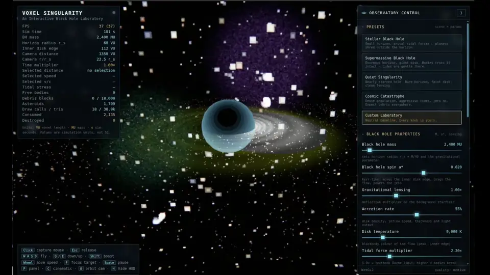

# SYNAPSE

**Run larger local models. Get more from the hardware you already own.**

<p align="center">
  <a href="https://github.com/appatalks/Synapse/releases/download/v0.1.0rc2/blackhole-synapse.mp4">
    
  </a>
  <br>
  <em>A black hole made with Synapse using Qwen3.8-Flash-Next.</em>
</p>

SYNAPSE brings local chat, model controls, hardware monitoring and an
OpenAI-compatible API into one app. Optional experimental acceleration shares
Mixture-of-Experts (MoE) work between the GPU and CPU.

> **Release candidate:** Experimental acceleration is not broadly
> quality-qualified. Standard execution remains available; check important
> answers independently.

## Why use it?

On one test system, the optional Linux/NVIDIA research backend improved
generation on four larger-than-VRAM models without changing target weights or
skipping selected experts:

| Model | Matched control | Accelerated | Gain |
| --- | ---: | ---: | ---: |
| GPT-OSS-120B MXFP4 | 25.69 tok/s | **39.46 tok/s** | **54%** |
| Qwen3.8-Flash-Next IQ3_S | 25.39 tok/s | **43.88 tok/s** | **73%** |
| GLM-4.5-Air 106B IQ4_XS | 12.67 tok/s | **17.28 tok/s** | **36%** |
| Qwen3.6-35B-A3B Q8_0 | 45.50 tok/s | **77.99 tok/s** | **71%** |

These are three-run, 512-token medians at 16K context on a Ryzen 9 9950X,
RTX 5070 Ti 16GB and 123.48 GiB RAM. Controls differ: GPT and Qwen3.6 use
automatic placement, Qwen3.8 uses CPU experts, and GLM uses the fastest tested
non-hybrid control. GLM used a 6 GiB cache; its 8 GiB attempt did not fit.
These are not universal speed or quality guarantees: some strict reference
comparisons and an earlier answer check failed. See the
[benchmark details](docs/benchmarks/README.md), [model guide](docs/benchmarks/model-guide.md),
[compatibility limits](docs/compatibility.md) and
[technical white paper](docs/whitepaper/synapse-whitepaper.pdf).

## Install

### Let your agent set it up

Prefer guided setup? Paste this into your AI coding agent with terminal access:

```text
Set up SYNAPSE from https://github.com/appatalks/Synapse on this computer.
Read its README and installation guide, check my operating system and Python
version, look for an existing llama-server, and ask where my GGUF models are.
Explain the proposed setup and ask for my approval before installing software,
downloading models, changing existing settings or backends, modifying drivers,
or restarting services. Use the documented per-user installation for my
platform; do not use sudo by default. After approval, start the app, verify the
local endpoint and report any remaining steps. Do not download model weights
or replace an existing backend without approval.
```

### Install it yourself

On **Linux or macOS**, with Python 3.10+ and curl:

```bash
curl -fsSL https://raw.githubusercontent.com/appatalks/synapse/main/install.sh | bash -s -- --launch
```

The installer runs per-user and opens the app. A compatible llama-server and
your own GGUF model are required. Linux can optionally build experimental
NVIDIA acceleration; drivers, toolkits and models are not installed
automatically. It prefers a checksummed release and labels a source fallback as
a preview. You can [review the installer](install.sh) first or supply an existing
backend with `--llama-server /path/to/llama-server`.

**Windows:** download `SYNAPSE.pyz` from [Releases](https://github.com/appatalks/synapse/releases)
and run `py SYNAPSE.pyz --llama-server C:\path\to\llama-server.exe`.
See the [installation guide](docs/installing.md) for all platforms and options.

## Open it. Pick a model. Go.

1. In **Chat → Model Controls**, select an existing GGUF or explicitly download
   one from the model library. For split models, download all shards and select
   the first.
2. Load the model and chat. Use [Auto Tune](docs/application_notes.md#auto-tune)
   to check capacity and measure supported engines on your system.
3. Open **Monitor** for hardware and generation metrics, or **Connect an app**
   to use the local API. [See the monitor](assets/screenshot-testing.png).

[Strata](https://github.com/Niko1221/Strata) inspired this project; SYNAPSE is
independent and does not bundle Strata. Experiments and backend research live
in [unified-memory-scheduler](https://github.com/appatalks/unified-memory-scheduler).

---

**Local-only API:** do not expose it to the network. [Details](docs/application_notes.md#local-only-api).

[Installation](docs/installing.md) · [Monitoring](docs/monitoring.md) ·
[Application notes](docs/application_notes.md) · [Development](docs/releasing.md) · [MIT license](LICENSE)
